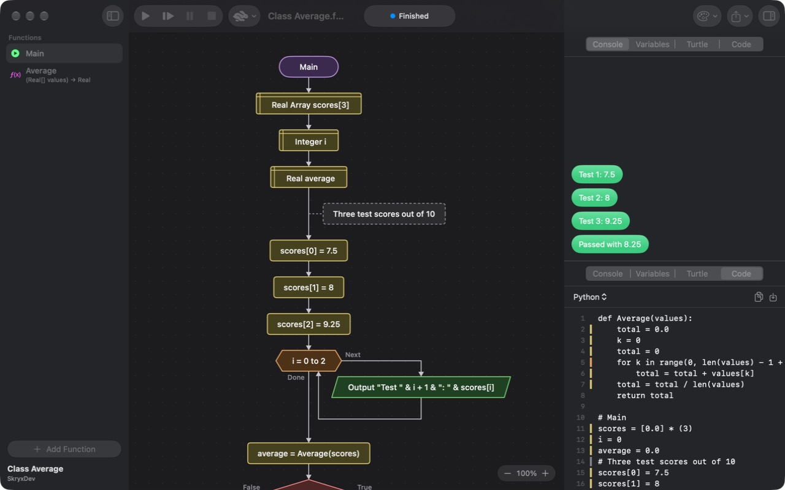

<p align="center">
  
</p>

<h1 align="center">FlowGorithmForMac</h1>

<p align="center">
  Write and run programs as flowcharts on the Mac — native, fast, and compatible with Flowgorithm's <code>.fprg</code> files.
</p>

<p align="center">
  
  
  
  
</p>

<p align="center">
  
</p>

---

FlowGorithmForMac is a flowchart programming environment built from scratch in Swift and SwiftUI for
macOS 26 Tahoe and later. Build a program by inserting shapes on the chart, run it one shape at a time
while you watch the variables change, and read the same program as Python, Java or C++ next to it.
It opens and saves the `.fprg` files of [Flowgorithm](http://www.flowgorithm.org), so exercises and
assignments move freely between a Windows PC at school and a Mac at home.

## Features

- **Every shape** — Declare, Assign, Input, Output, If, While, For, Do, Call, Comment and Breakpoint,
  plus file I/O (Open, Read, Write, Close) and turtle graphics (Forward, Turn, Home, Clear, Pen).
- **Same rules as Flowgorithm** — explicit declarations, real division, `&` to join text, case-insensitive
  names, functions with array parameters, and all the built-in functions (`Sqrt`, `Len`, `ToFixed`,
  `Random`, `Size`…). Operators can be typed C-style, BASIC-style or as math symbols (`&&`, `and`, `∧`).
- **Quick editing** — click the <kbd>+</kbd> on any arrow to insert a shape, double-click to edit, drag to move,
  right-click for cut, copy, paste and duplicate, with undo. Expressions are checked as you type,
  and errors are explained in plain words.
- **Run, step, pause** — adjustable speed from full speed to very slow, breakpoints, and the running shape
  highlighted and scrolled into view. Runaway recursion stops with a clear error instead of freezing.
- **Panels** — a chat-style console (or plain text), a variable watch colored by type with arrays,
  a turtle graphics canvas, and the source code. Show one or two at a time.
- **Live source code** in Python, Java, C++, C#, JavaScript, TypeScript, Swift and Kotlin, plus pseudocode
  in English and Italian. Each line is linked to its shape; copy it or save it to a file.
- **Five color schemes** — Classic, Modern, Pastel, Neon and Black & White, all following light and dark mode.
- **Export** the chart to PNG, PDF or SVG, or print it.
- **English and Italian**, following the system language or chosen in Settings.
- **Lightweight** — a 3.6 MB app with no dependencies that stays responsive even when a program prints
  millions of lines.

### Keyboard shortcuts

| Keys | Action |
| --- | --- |
| <kbd>⌘</kbd><kbd>R</kbd> or <kbd>F5</kbd> | Run, or continue after a pause |
| <kbd>⌘</kbd><kbd>'</kbd> or <kbd>F6</kbd> | Step to the next shape |
| <kbd>⌥</kbd><kbd>⌘</kbd><kbd>P</kbd> or <kbd>F7</kbd> | Pause |
| <kbd>⌘</kbd><kbd>.</kbd> or <kbd>F8</kbd> | Stop |
| <kbd>⇧</kbd><kbd>⌘</kbd><kbd>F</kbd> | Add a function |
| <kbd>⇧</kbd><kbd>⌘</kbd><kbd>I</kbd> | Program info (name, author, description) |
| <kbd>⌘</kbd><kbd>X</kbd> <kbd>⌘</kbd><kbd>C</kbd> <kbd>⌘</kbd><kbd>V</kbd> | Cut, copy and paste shapes |
| <kbd>⌘</kbd><kbd>D</kbd> | Duplicate the selected shape |
| <kbd>⌫</kbd> | Delete the selected shape |
| <kbd>⌘</kbd><kbd>+</kbd> <kbd>⌘</kbd><kbd>-</kbd> <kbd>⌘</kbd><kbd>0</kbd> | Zoom in, zoom out, actual size (or pinch) |
| <kbd>⌥</kbd><kbd>⌘</kbd><kbd>1</kbd> … <kbd>⌥</kbd><kbd>⌘</kbd><kbd>4</kbd> | Show the console, variables, turtle or source code |
| <kbd>F9</kbd> <kbd>F10</kbd> <kbd>F11</kbd> <kbd>F12</kbd> | Show the variables, console, turtle or source code, as in Flowgorithm |
| <kbd>⌥</kbd><kbd>⌘</kbd><kbd>I</kbd> | Show or hide the panels |
| <kbd>⌘</kbd><kbd>P</kbd> | Print the flowchart |
| <kbd>esc</kbd> | Close the insert menu |

The **Program** menu also sets the speed, ignores or removes all breakpoints, and **File › Export Flowchart**
saves the chart as an image.

## Install

1. Download **FlowGorithmForMac-1.0.0-beta.dmg** from the
   [latest release](https://github.com/SkryxDev/FlowGorithmForMac/releases/latest).
2. Open it and drag **FlowGorithmForMac** into **Applications**.
3. The app is not notarized yet, so macOS blocks it the first time. Open it once, then go to
   **System Settings › Privacy & Security** and click **Open Anyway** — or run:

   ```bash
   xattr -dr com.apple.quarantine /Applications/FlowGorithmForMac.app
   ```

It needs a Mac with Apple silicon and macOS 26 Tahoe or later. The app opens on an empty flowchart,
ready to edit and save.

## Safe with flowcharts from others

A `.fprg` file can come from anyone, so opening and running one can't harm your Mac:

- Programs read and write files in the flowchart's own folder freely. For any other file — another folder,
  `..`, `~`, a link pointing elsewhere, or every file of a flowchart not saved yet — the program pauses and
  the app shows the full path and asks first. **Block** stops the program with an error on that shape.
- Folders, devices and files over 32 MB are refused.
- Opening a file never loads external XML entities, and absurdly deep shapes or expressions are refused
  with a clear error instead of crashing the app.
- Arrays and texts have a memory limit, and the console stays responsive even when a program prints without end.

## Build from source

Requirements: **macOS 26** or later and **Xcode 26** or later. There are no third-party dependencies.

```bash
git clone https://github.com/SkryxDev/FlowGorithmForMac.git
cd FlowGorithmForMac
open FlowGorithmForMac.xcodeproj
```

Then press <kbd>⌘</kbd><kbd>R</kbd> in Xcode. To build a release copy from the command line instead:

```bash
xcodebuild -project FlowGorithmForMac.xcodeproj -scheme FlowGorithmForMac -configuration Release -derivedDataPath build/DerivedData build
```

The app is written to `build/DerivedData/Build/Products/Release/FlowGorithmForMac.app`; copy it to `/Applications`:

```bash
ditto build/DerivedData/Build/Products/Release/FlowGorithmForMac.app /Applications/FlowGorithmForMac.app
```

The language core has its own tests:

```bash
cd FlowCore && swift test
```

To build the drag-to-install disk image used for releases:

```bash
Scripts/make-dmg.sh 1.0.0-beta
```

The image is written to `dist/FlowGorithmForMac-<version>.dmg` and its SHA-256 is printed. The app is signed
ad hoc; set `SIGN_IDENTITY="Developer ID Application: …"` and `NOTARY_PROFILE` to sign and notarize it
with your own Developer ID (see the script).

Command-line builds don't update the string catalog. After building, run the sync script; Italian texts
live in `Scripts/translations-it.json`, and the script lists any string still missing a translation:

```bash
python3 Scripts/sync-strings.py build/DerivedData
```

The icon's glyph layers are drawn by a script; after changing the artwork run:

```bash
swift Scripts/make-icon-glyph.swift FlowGorithmForMac/AppIcon.icon/Assets
```

## How it works

```
FlowCore/                 Swift package with no UI, tested with swift test
├── Model/                Programs, functions, shapes and data types
├── FPRG/                 .fprg reader and writer
├── Expressions/          Lexer and parser
├── Runtime/              Compiler, interpreter, built-in functions, errors
└── CodeGen/              Python, Java, C++, C#, JavaScript, TypeScript, Swift, Kotlin, pseudocode
FlowGorithmForMac/        The SwiftUI app
├── App/                  Entry point, menus, document and settings keys
├── Chart/                Chart layout, shapes, the insert menu, export
├── Editors/              Shape and function editors, the expression field
├── Model/                Editor state, run session, error and shape texts
├── Panels/               Console, variables, turtle and source code
├── Settings/             Settings window
├── Theme/                The five color schemes
└── Views/                Document window and sidebar
Scripts/                  DMG packaging, string catalog sync, icon drawing
```

- `.fprg` files are XML. They are read with `XMLDocument`, with external entities turned off, and written
  in the same layout Flowgorithm uses (file version 4.2), so files open in both apps.
- Expressions go through a hand-written lexer and a precedence-climbing parser with limits on nesting and
  length. Before a program runs, every shape is parsed and lowered to a small tree, so syntax errors show up
  before anything happens; the editor runs the same check on each shape as you type.
- The interpreter is `async` and runs on a thread of its own with a 64 MB stack. Expressions without user
  function calls are evaluated synchronously; calls use the interpreter's own call stack, whose depth is set
  in Settings. Stepping, pausing, input and file permission requests all go through one execution controller,
  and the console receives output as a stream, so a program printing without end can't flood the window.
- The source code panel generates every language from the same program model; each generated line remembers
  which shape it came from.
- The chart has its own layout engine; shapes are drawn with SwiftUI, and SVG export has its own writer.
  Window layout, panels and settings are remembered between launches.

## License

FlowGorithmForMac is free software: you can redistribute it and/or modify it under the terms of the
[GNU General Public License version 3](LICENSE), with the additional attribution terms in [NOTICE](NOTICE).
Whoever distributes it, modified or not, must share the source under the same license and keep the credit
"Based on FlowGorithmForMac by SkryxDev", showing it in the app's About window or a similar screen.
The app comes with no warranty.

## Credits

Made by **[SkryxDev](https://github.com/SkryxDev)**.

FlowGorithmForMac is an independent, clean-room project. It is not affiliated with or endorsed by
[Flowgorithm](http://www.flowgorithm.org) or its author, Devin Cook. No code from the original application
is used: everything is based on its public documentation, the `.fprg` format and its observable behavior.
